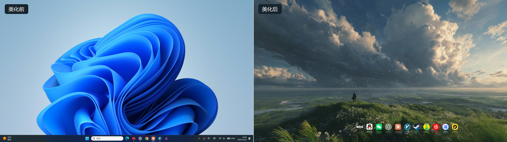
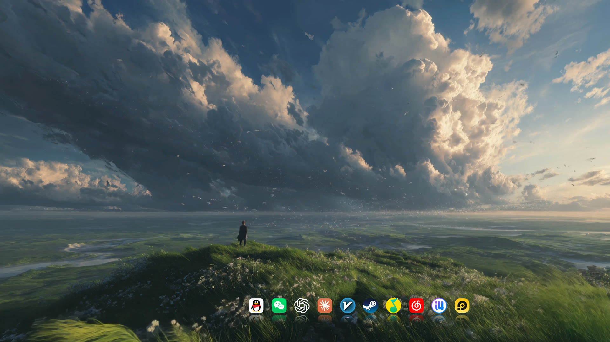
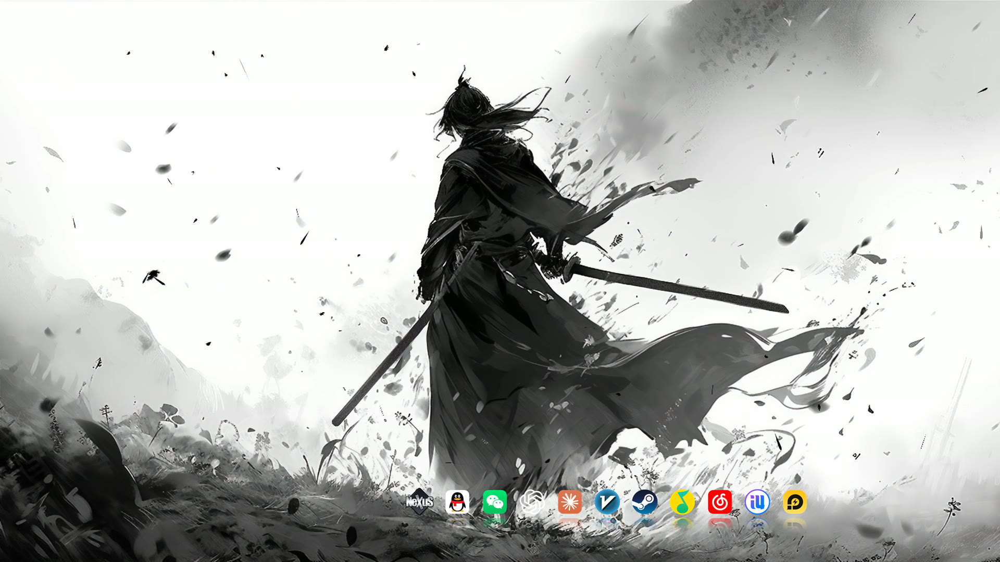
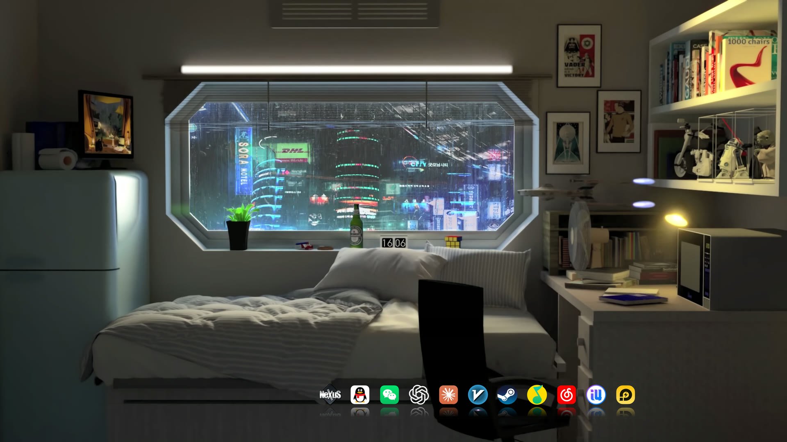
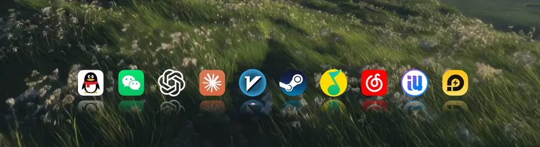

<div align="center">

# 🌄 Win11 动态桌面 · 一键复刻

我想让桌面留给风景，把常用软件收进一排 Dock。



<table>
<tr>
<td width="33%"></td>
<td width="33%"></td>
<td width="33%"></td>
</tr>
<tr>
<td align="center">风景</td>
<td align="center">水墨</td>
<td align="center">赛博朋克</td>
</tr>
</table>



鼠标划过，图标放大。

</div>

先装好 Wallpaper Engine 和 Nexus，下载本仓库，在文件夹里运行：

```powershell
powershell -ExecutionPolicy Bypass -File .\install.ps1
```

[▶ 看演示](docs/DEMO.md)

[安装准备、使用与还原、兼容性、壁纸画廊 →](docs/GUIDE.md)
