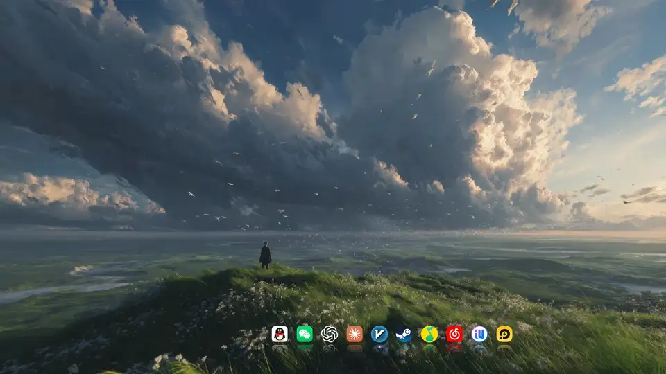

<div align="center">

# 🌄 Win11 动态桌面 · 一键复刻

动态壁纸 + macOS 风格 Dock + 隐身任务栏，让 Windows 11 桌面干净、会动。


**[▶ 看演示](#动起来是这样)** · **[开始安装](#开始安装)** · **[壁纸画廊](wallpapers.md)**

</div>

### 准备条件

- **两款软件**：Wallpaper Engine（Steam 付费，常年打折）和 Winstep Nexus（免费）。
- **脚本负责**：设置任务栏和桌面、导入 Dock 外观和图标列表、设置壁纸登录后自动启动。
- **你来完成**：安装两款软件，先打开一次 Nexus；订阅并选择壁纸，在 Wallpaper Engine 里取消「高优先级」。

## 动起来是这样



<sub>60 帧实录，没有加速：云和草在动 → 鼠标慢慢划过 Dock → 碰到屏幕底边呼出任务栏 → 回到桌面</sub>


<sub>Dock 特写：软件原图标统一成同样的视觉大小，圆形图标稍微放大一点，整排看起来一样大</sub>

演示来自 Windows 11、2560×1440。分辨率、缩放比例和软件版本不同，效果可能略有差别。

## 安装后会得到什么

| 方式 | 内容 |
| --- | --- |
| 自动设置 | 任务栏改成深色并自动隐藏，鼠标移到屏幕最底部才出现；隐藏桌面图标，让壁纸完整露出来 |
| 自动导入 | 导入外观（底部居中、划过放大、倒影、运行指示点），图标列表按最后一行的选择处理。 |
| 自动设置 | Wallpaper Engine 登录后 10 秒自动启动；原来有同名自启任务时，会先完整备份 |
| 手动完成 | 从 [14 张精选壁纸](wallpapers.md)中订阅并选择喜欢的水墨、赛博朋克、动漫或风景壁纸；取消「高优先级」 |
| 按你的选择和检测结果 | 保留 Dock 现有软件（推荐），或换成自动检测到的常用软件；只查下列 8 款的常见安装位置 |

常用软件列表：资源管理器、Edge、Chrome、QQ、微信、Steam、QQ 音乐、网易云音乐。图标从你电脑上的软件里提取，统一视觉大小，不需要下载。

## 开始安装

> [!IMPORTANT]
> 所有脚本只改**当前用户**的设置，**不需要管理员权限**。请不要「以管理员身份运行」：如果平时用的不是管理员账户，用别的账户提权会改到那个账户的设置。

### 1. 安装软件，下载仓库

安装 [Wallpaper Engine（Steam）](https://store.steampowered.com/app/431960/Wallpaper_Engine/) 和 [Winstep Nexus（官网）](https://www.winstep.net/nexus.htm)。装完 Nexus 后**先打开一次**，等底部出现 Dock 再继续。

点页面上方绿色的 **Code → Download ZIP**，解压到任意位置。

### 2. 运行安装脚本

在解压出来的文件夹里，**按住 Shift + 右键空白处** →「在终端中打开」，粘贴并回车：

```powershell
powershell -ExecutionPolicy Bypass -File .\install.ps1
```

脚本会先检查软件是否安装，问你一次确认，再依次设置任务栏和桌面、导入 Dock、设置壁纸自启。导入 Dock 时会让你选择**保留现有软件**（推荐）或**换成常用软件**。

全程大约 10 秒，任务栏和 Dock 会闪一下。最后会列出每一步是「成功」「跳过」还是「失败」，某一步失败不会影响其他步骤。

改动前会自动备份到仓库里的 `backup\` 文件夹，**还原前请不要删除它**。

### 3. 选择壁纸，关闭高优先级

打开 **[壁纸画廊](wallpapers.md)**，点喜欢的那张，在 Steam 页面点「订阅」，然后在 Wallpaper Engine 里选中它。

在 Wallpaper Engine 设置里**取消勾选「高优先级」**，否则它会切回依赖后台服务启动的模式。

<table>
<tr>
<td><a href="wallpapers.md#治愈--风景"></a></td>
<td><a href="wallpapers.md#水墨--国风"></a></td>
<td><a href="wallpapers.md#赛博朋克"></a></td>
</tr>
<tr>
<td align="center"><sub>风景</sub></td>
<td align="center"><sub>水墨</sub></td>
<td align="center"><sub>赛博朋克</sub></td>
</tr>
</table>

## 换成你自己的样子

- **增添软件**：把游戏或软件拖到 Dock 上；安装时选择「保留现有软件」，可以保留自己的列表并统一图标大小。
- **更换壁纸**：去 [壁纸画廊](wallpapers.md)订阅并选择另一张；不用的壁纸在 Wallpaper Engine 里右键 →「取消订阅」。
- **调整大小**：右键 Dock → **Preferences**。当前图标为 48 px，鼠标划过放大到 128 px；主题、间距、倒影等完整参数见 [Dock 配置](docs/DOCK.md)。

调好后可以运行 `scripts\export-nexus.ps1` 分享自己的 Dock 外观，不会带上软件路径、天气城市等个人信息。

## 还原

在仓库文件夹里运行：

```powershell
powershell -ExecutionPolicy Bypass -File .\restore.ps1
```

还原范围是 `backup\` 中备份的脚本改动：

- 任务栏和桌面的 5 项设置恢复成原来的值。
- Nexus 配置整块恢复；恢复前先另存当前配置，万一失败会自动退回。
- Wallpaper Engine 自启任务：原来就有的恢复原设置，原来没有的删掉。

某一步没还原成功，会显示「失败」，对应备份保留不删，可以再运行一次。

## 常见问题

### 开机后壁纸不出来？

安装脚本已设置登录后 10 秒启动的计划任务。请在 Wallpaper Engine 设置里取消「高优先级」；原因、单独修复命令和撤销方法见 [壁纸自启踩坑记录](docs/TROUBLESHOOTING.md)。

### Dock 突然不见了？

Nexus 有时开机后没跑起来，或被不小心关掉。配置还在，开始菜单搜索 **Nexus** 并打开，Dock 会原样回来。

### 隐藏桌面图标后找不到软件？

把它拖到 Dock，或从开始菜单固定到任务栏；也可以桌面右键 →「查看」→ 勾选「显示桌面图标」。

磁盘占用、性能与电池设置，以及上述问题的完整记录见 **[踩坑记录](docs/TROUBLESHOOTING.md)**。

## 兼容性摘要

已测试环境：**Windows 11 家庭中文版、2560×1440、PowerShell 5.1**，覆盖安装、重复安装、还原、备份损坏时的报错；也测过非系统盘 Steam 库和已有同名壁纸自启任务的备份还原。

Windows 10、非中文系统、多显示器、高缩放比例和 PowerShell 7 **尚未验证**。详见 [兼容性表](docs/COMPATIBILITY.md)；在其他环境用过，欢迎[提个 Issue](../../issues/new/choose) 告诉我结果。

## 致谢与许可

感谢壁纸作者，以及 Wallpaper Engine 和 Winstep Nexus 的开发者。壁纸版权归各自作者所有，本仓库只引用 Steam 创意工坊的链接和预览图；这两款软件属于各自开发者，本仓库与它们没有关联。

脚本和教程采用 [MIT 许可](LICENSE)。版本变化见 [更新日志](CHANGELOG.md)。
